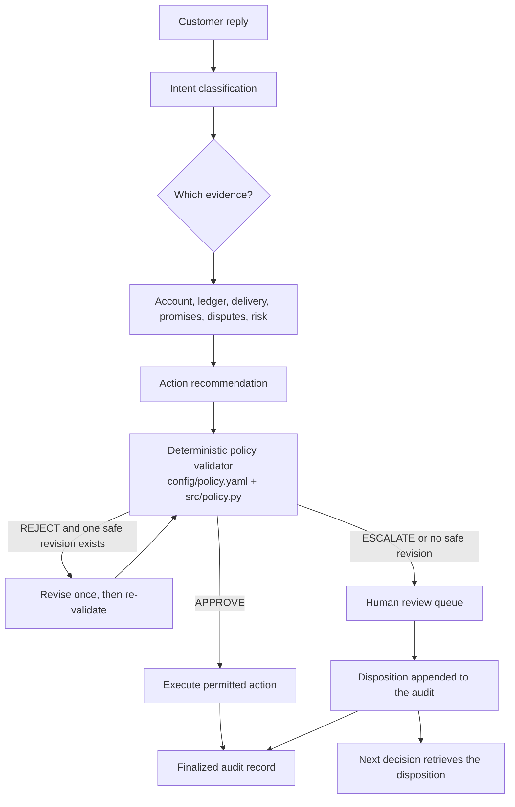

# Cleartide ACA architecture

The Autonomous Collections Agent is a bounded decision loop. The reasoning step recommends. The policy step authorizes. A human disposition is recorded when the agent stops. The audit row is finalized once.

What each box owns:

| Stage | Code | What it may do |
|---|---|---|
| Intent | `src/agent.py` `mock_classify_reply` | Choose one of seven intents. Development classifier is deterministic. |
| Tools | `src/tools.py`, `src/tool_guard.py` | Read exact relational rows. No tool may invent a balance. |
| Recommendation | `src/agent.py` mock recommenders | Propose action, channel, and draft from the retrieved evidence. |
| Policy | `src/policy.py`, `config/policy.yaml` | Approve, reject, or escalate. This is the authority. |
| Revision | `revise_action_node` | One SMS-to-email correction. No other workaround. |
| Human review | `src/review.py` | Record APPROVE, REJECT, MODIFY, or RESOLVED once. |
| Audit | `src/audit.py` | Write the decision, then refuse to rewrite it. Append a note for the disposition. |

The live dashboard draws the same path as eight steps: intent, tools, evidence, risk, action, policy verdict, outcome, audit.
